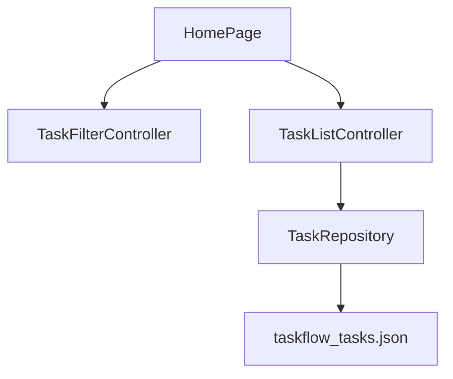

# TaskFlow

TaskFlow is an offline task list. You can add, edit, complete, and delete tasks, then filter them by status, priority, due date, and text.

**The app has no server.** Tasks are stored in a JSON file on the device. Closing the app does not upload anything. "Offline-first" here means the file is the source of truth, not that a sync queue is retrying against a backend.

The app is not published to an app store.

## Problem

Productivity apps often hide the hard part: what happens when storage fails, and how due dates are compared. TaskFlow keeps that logic in testable Dart, with Riverpod only as the state layer.

## Features

- Create, edit, complete, and delete tasks
- Priority, optional due date, category, and labels
- Search across title, notes, category, and labels
- Filters: All, Open, Done, Overdue
- Sort by due date, priority, title, or created date
- Counts for open, done, and overdue tasks
- Confirmation before delete and before restoring sample data
- Light and dark themes, saved on device
- Loading, empty, and error states, with retry

## Screenshots

Screenshots have not been captured. Verification so far is `flutter analyze` and `flutter test` on Flutter 3.44.9.

## How offline storage works



1. On first launch, `FileTaskRepository` writes `sampleTasks` into `taskflow_tasks.json` under the app documents directory.
2. Later launches read that file. Edits call `save` with the full list.
3. There is no `Dio` client and no sync cursor. Airplane mode does not change behavior, because the network is never used.
4. A future sync API should be a new `TaskRepository` implementation. The pages should keep talking to `TaskListController`.

Dates are `yyyy-MM-dd`. A task is overdue when it is not complete, it has a due date, and that calendar day is before today. A task due today is not overdue. A completed task is never overdue.

## Folder structure

```text
lib/
  main.dart
  app.dart              ProviderScope overrides
  bootstrap.dart        documents-directory files for the real app
  providers.dart        Riverpod notifiers
  theme.dart
  domain/task.dart      model, filters, stats, validation
  domain/stores.dart    repository contracts
  data/                 sample tasks, JSON file, memory fakes
  presentation/         home page and editor sheet
test/
```

## Stack

| Choice | Why |
| --- | --- |
| Riverpod `AsyncNotifier` | The task list is loaded asynchronously and then mutated in place. |
| Separate filter notifier | Typing in search must not reload the file. |
| JSON file | One list, easy to inspect, testable with a temp file. |
| No code generation | The notifiers are small enough to write by hand. |

`ProviderScope` overrides inject the repository. Tests never read the documents directory.

## Setup

Flutter 3.44.9, Dart 3.12.2.

```bash
flutter pub get
flutter run
```

No API keys and no `.env` file.

## Testing

Verified locally on 12 October 2026 with Flutter 3.44.9:

- `flutter analyze` — no issues
- `flutter test` — 10 tests passed

CI is defined in `.github/workflows/ci.yml` and has not run on GitHub yet. Coverage was not measured.

```bash
dart format --output=none --set-exit-if-changed .
flutter analyze
flutter test
```

## Known limitations

- The whole list is rewritten on every save. That is fine for a short personal list.
- Filters and sort are not persisted.
- Labels are capped at six, silently, in `TaskRules.parseLabels`.
- No reminders, notifications, or accounts.
- Layout was checked at 390×844 in a widget test. It has not been run on a device for screenshots.

## Future improvements

- Persist the filter
- Tell the user when labels were truncated
- Add a sync repository only when there is a real backend to test against
- Capture screenshots on a device

## Interview notes

See [INTERVIEW_GUIDE.md](INTERVIEW_GUIDE.md).

## License

[MIT](LICENSE) © 2026 Shubham Tomar

## Links

- Author: Shubham Tomar — shubhamtomarr68@gmail.com
- GitHub: https://github.com/shubhamtomarr68-hub/flutter-taskflow
